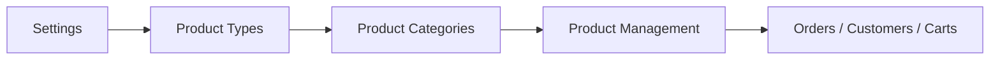

# Commerce

> Menu: left sidebar **Commerce** group (must be enabled in **Edit menu**)  
> Route prefix: `/_Admin/commerce/...?SiteId={siteGuid}`

The **Commerce** module manages products, orders, carts, shipping, discounts, and more in the Kooboo site admin. Storefront checkout and product data are read/written via [k.commerce](../../api/commerce/commerce.md); this series documents **admin menu and page operations**.

::: tip Difference from the Content module
| | **Content** | **Commerce** |
|--|----------|----------|
| Typical use | Articles, banners, non-transactional structured content | Product SKUs, orders, inventory, checkout |
| Admin | Content -> Content Types / Content Folders | Commerce -> Product Types / Product Management |
| API | `k.content` | `k.commerce` |
:::

## How to Open

1. In the [Edit menu](../navigation.md#edit-menu), enable **Commerce** and its children (some sub-items are also marked `advanced`).
2. Expand **Commerce** in the left sidebar.

## Submenus (same order as admin)

| Menu | Path | Docs |
|------|------|------|
| Product Management | `/commerce/product-management` | [List](./product-management.md) · [Detail](./product-management-detail.md) |
| Product Types | `/commerce/product-types` | [Product types](./product-types.md) |
| Product Categories | `/commerce/product-categories` | [Product categories](./product-categories.md) |
| Carts | `/commerce/carts` | [Carts](./carts.md) |
| Customers | `/commerce/customers` | [Customers](./customers.md) |
| Orders | `/commerce/orders` | [Orders](./orders.md) |
| Sale Stats | `/commerce/sale-stats` | [Sale stats](./sale-stats.md) |
| Discounts | `/commerce/discounts` | [Discounts](./discounts.md) |
| Currencies | `/commerce/currencies` | [Currencies](./currencies.md) |
| Shipping | `/commerce/shippings` | [Shipping](./shippings.md) |
| Loyalty | `/commerce/loyalty` | [Loyalty](./loyalty.md) |
| Tax | `/commerce/taxes` | [Tax](./taxes.md) |
| Notification | `/commerce/notification` | [Notification](./notification.md) |
| Settings | `/commerce/settings` | [Settings](./settings.md) |

## Recommended Setup Order

**Settings** is last in the menu, but when first enabling commerce, **read and save settings first**, then configure types, categories, and products (implementation order differs from menu order):

1. [Settings](./settings.md) — weight unit, payment methods, product/category custom fields, etc.  
2. [Product types](./product-types.md) — define product fields and whether digital.  
3. [Product categories](./product-categories.md) — category tree and display fields.  
4. [Product management](./product-management.md) — list and publish; variants etc. in [product detail](./product-management-detail.md).  
5. During operations, configure [discounts](./discounts.md), [shipping](./shippings.md), [currencies](./currencies.md), [tax](./taxes.md), etc.

## Related

| Doc | Description |
|-----|-------------|
| [k.commerce](../../api/commerce/commerce.md) | Products, carts, orders, and other APIs |
| [k.payment](../../api/payment/index.md) | Payment channels (works with payment methods in settings) |
| [Site admin menu overview](../navigation.md) | Full menu tree |
