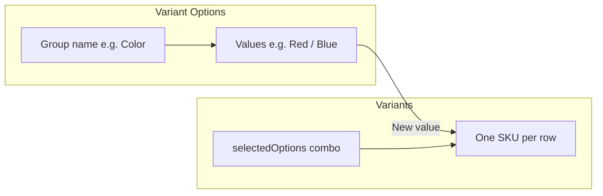

# Product Detail (Create and Edit)

> **Create**: `/_Admin/commerce/product-management/create?SiteId=...&typeId={typeId or blank}`  
> **Edit**: `/_Admin/commerce/product-management/edit?SiteId=...&id={productId}`

Full-screen form after [creating a product](./product-management.md) on the list or clicking **Edit**; top to bottom: **Basic information**, [custom fields](#custom-fields) (if any), **variant options and variants** (when variants not hidden); **digital products** also require [digital product](#digital-products) delivery per variant table. Save returns to [product management list](./product-management.md).

::: tip Relationship with list
| Page | Doc |
|------|------|
| List, filters, duplicate, batch delete | [Product management (list)](./product-management.md) |
| This form | This page |
:::

## How to Enter

| Method | Route |
|--------|-------|
| **Create** | List **Create product** → choose "Blank product" or a **product type** (for digital, choose type with [digital product](./product-types.md#digital-products) checked) → `product-management/create?typeId=...` |
| **Edit** | List row edit → `product-management/edit?id=...` |

Breadcrumb usually: **Product Management -> Edit product** (create title may differ per UI).

Bottom fixed **Cancel / Save / Save and return** (`KBottomBar`), similar to content entry edit.

## Basic Information

First white card (`BasicInfo`). Multilingual sites have **Multilingual** switch top-right; fields below can be maintained per default and each language.

<DocImage src="/cms/commerce/product-management-detail-basic.png" alt="Product detail: basic info name SEO image description categories tags active" width="1120" />

| Field | Description |
|-------|-------------|
| **Product name** (`title`) | Required; storefront display title. Multilingual: default `title` plus each language in `customData.title` |
| **SEO name** (`seoName`) | Required; friendly URL. Cannot contain `[]\{}#%^*+=_\|~<>.?!'"/:;,()$&@` or whitespace; unique site-wide. Input can generate suggestion from title (`SeoName` component, `path=product`) |
| **Images** (`images` / `featuredImage`) | From [media library](../site/media.md); set **featured image** (`featuredImage`). Gallery and featured metadata in `imageMetas` |
| **Description** (`description`) | Rich text (`KEditor`); multilingual same as title |
| **Categories** (`categories`) | Tags for selected categories; green **+** opens picker linking [product categories](./product-categories.md). Manual categories: delete on tag |
| **Tags** (`tags`) | Enter new or select existing product tags |
| **Active** (`active`) | Toggle: sellable on storefront |

Field **display names** configurable in [product types](./product-types.md) / [settings](./settings.md) **product custom fields** (system fields like Title, SeoName, etc.).

### Attributes (optional)

When [settings](./settings.md) has **not** enabled "Hide attributes", basic info card bottom adds **Attributes**: key-value list (`KeyValueEditor`) for product-level attributes; no forced 1:1 with variant dimensions below; fill as needed.

## Custom Fields

**Product custom fields** (non-system) from [settings](./settings.md) rendered by `CustomData`, between basic info and variant sections; types include text, select, image, etc., with dynamic options on [product types](./product-types.md). Hidden when no custom fields.

## How Variant Options Affect Variants

When [settings](./settings.md) has **not** enabled "Hide variants", lower section has **variant options** (`OptionGroupEditor`) and **variant table** (`VariantEditor`). Together they define storefront SKUs.

Key points (consistent with `product-variant.ts`):

| Action | Effect on variants |
|--------|-------------------|
| **Add option group** | Click **+** for empty group; need option name (e.g. `Size`) and at least one value before variant rows expand on that dimension |
| **Add value to existing group** | System **duplicates** new rows for variants **not yet containing** that value (no duplicate combos); existing combos unchanged |
| **Rename group / value** | Syncs `name` / `value` in all variant `selectedOptions` |
| **Delete a value** | If other variants still have other values on that dimension, **deletes** rows using that value; if only one value on dimension, **removes dimension** from rows |
| **Delete entire group** | Removes dimension from all variants and cleans related rows |
| **Add variant** (button) | With option groups defined, manually create SKU row; dialog picks value per dimension (no duplicate combo) |

Each **variant** is one separately priced, stocked, activatable SKU; `selectedOptions` is `{ name, value }[]`, e.g. `Color: Red` + `Size: M`. Storefront add-to-cart matches variant by selected combo.

## Variant Options

`OptionGroupEditor`: one card per option group, collapsible edit.

<DocImage src="/cms/commerce/product-management-detail-variant-options.png" alt="Variant options: group name, text or color type, value list" width="1120" />

| UI | Description |
|----|-------------|
| Group title | Click card to edit: **Option name** (e.g. Color, Size) |
| Type | **Text** or **Color**; color type uses color picker for values |
| Option values | Enter one by one; Enter or Tab to add. Display mode can show small image per value (`variantOptions.items[].image`) |
| Multilingual | When enabled, card **Language** icon edits translations for group and values |
| **Done** | End group edit; **Delete** icon removes entire group (triggers variant logic above) |
| Bottom **+** | Add new option group |

Option definitions write to product `variantOptions` (type, multilingual, per-item metadata) and link to **Options** column in variant table.

## Variant List

Below variant options is variant table; when at least one option group exists and first variant has `selectedOptions`, **Add variant** appears above table (UI copy for manual SKU creation).

<DocImage src="/cms/commerce/product-management-detail-variants.png" alt="Variant table: image, option combo, price, stock, sales, active, row actions" width="1120" />

| Column / Action | Description |
|-----------------|-------------|
| **Image** | Variant featured image; replaceable. If [settings](./settings.md) has meta template for Images, image metadata editable |
| **Options** | Current row `selectedOptions` display (e.g. `Red / M`) |
| **Price** | SKU price (currency symbol from [settings](./settings.md)) |
| **Stock** | `newInventory`: value written on save (with `originalInventory`; per API) |
| **Sales** | Read-only stats |
| **Digital product** | **Digital products** (`isDigital`) only; button opens delivery config; see [digital products](#digital-products) |
| **Active** | Whether SKU is sellable |
| **Edit** | Opens [edit variant dialog](#edit-variant-dialog) |
| **Delete** | Available when more than one variant row |

::: warning Digital product delivery
If [settings](./settings.md) enables **Digital product delivery required** and product is digital, **each variant** must have at least one digital delivery item before **Save**.
:::

## Digital Products

When product is from [product type](./product-types.md#digital-products) with **Digital product** checked, or `isDigital` is true after save, variant table shows **Digital product** column (physical products omit it). **Each variant SKU** configures what buyers receive after payment; different variants can have different files, links, or text.

### Open Configuration

In variant table **Digital product** column:

| State | Action |
|-------|--------|
| Not yet added | **Upload file** button (cloud upload icon) opens config dialog |
| One or more added | **Digital** button (count) opens same dialog |

Dialog title: **Digital product**.

<DocImage src="/cms/commerce/product-management-detail-digital-items.png" alt="Digital product dialog: add dropdown file/link/text, auto delivery, delivery list" width="960" />

### Three Ways to Add Delivery Items

Click **Add** (dropdown arrow on primary button) top-left; choose type; can add multiple per variant delivery package.

| Method / menu item | Use | Configuration |
|--------------------|-----|---------------|
| **File** | Downloadable attachment (PDF, ZIP, installer, etc.) | Select local file uploads immediately; list **Type** is "File", **Details** shows file size. Stored in site digital product storage, linked to variant `variantId` |
| **Link** | External resource (cloud drive, video page, third-party download) | Sub-dialog: **Name** (buyer-visible title) and **Link** (URL, multiline). **Details** shows link text (truncated if long) |
| **Text** | No file needed: license key, serial, instructions, account/password, etc. | Sub-dialog: **Name** and **Text** (multiline). Shown to buyer or used in email templates after order |

All three types appear in dialog table after save:

| Column | Description |
|--------|-------------|
| **Name** | Delivery item display name |
| **Type** | File / Link / Text (tag) |
| **Details** | File size; link and text show `value` summary |
| Row **Delete** | Remove item; **File** type on saved product may also delete remote uploaded file |

Same variant can mix types (e.g. PDF **file** + activation **text** + backup **link**).

### Auto Delivery

Toolbar right **Auto delivery** checked by default. When checked, system can auto-send delivery to buyer per commerce rules when order conditions met; unchecked requires manual or other flow. Triggers and email templates: [shipping](./shippings.md) and site commerce settings.

Close dialog when done; repeat for **each variant row** (multi-variant digital products each have own `digitalItems`).

### Relationship with Save and Storefront

- On save, if **Digital product delivery required** enabled, empty `digitalItems` on any variant shows **Digital content cannot be empty** and blocks submit.
- Type **download count / day limits** defined on [product type](./product-types.md#digital-products); complements "what to deliver" in this dialog.
- Storefront add-to-cart, checkout, and `k.commerce` read variant-level `digitalItems`; development: [k.commerce](../../api/commerce/commerce.md).

## Edit Variant Dialog

Click row **Edit** to open edit variant dialog.

<DocImage src="/cms/commerce/product-management-detail-variant-dialog.png" alt="Edit variant dialog: large image, dimension values, price weight stock SKU etc." width="460px" />

| Item | Description |
|------|-------------|
| Variant image | Large image area; can default to product featured image |
| **Variant options** | One row per dimension: `Name` (read-only) + `Value` (dropdown from existing values on that dimension across product variants) |
| **Price / Weight / Stock** | Number inputs |
| **SKU / Barcode** | Text |
| **Tags** | Variant-level tags (independent from product tags) |
| **Active** | SKU toggle |

Confirm writes back to table row; changing dimension value syncs name in `variantOptions`.

## Add Variant Dialog

Click **Add variant** opens dialog (title often **Create**); same structure as edit, but dimension **values** must be reselected (initially empty). New row appended; uses product **featured image** when no image selected.

<DocImage src="/cms/commerce/product-management-detail-variant-create-dialog.png" alt="Add variant dialog: select value per variant dimension" width="460px" />

Combo must not duplicate existing variant; dropdown options from values already on current product.

## Bottom Action Bar

| Button | Description |
|--------|-------------|
| **Cancel** | Return to list without saving |
| **Save** | Validates basic info and custom fields; digital products validate delivery (if required) |
| **Save and return** | On success, return to [list](./product-management.md) |

## Related

- [Product management (list)](./product-management.md) — includes [digital products](./product-management.md#digital-products) entry notes  
- [Product types](./product-types.md) — [create digital product type](./product-types.md#digital-products)  
- [Commerce settings](./settings.md) — digital product delivery required, etc.  
- [Shipping](./shippings.md) (physical / digital products, auto delivery)
