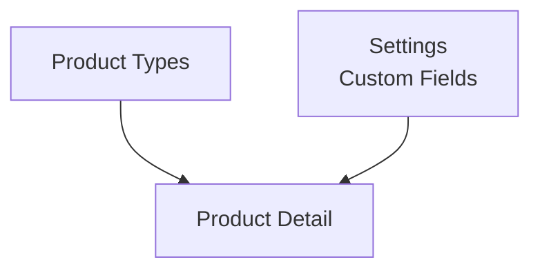

# Product Types

> Menu: **Commerce -> Product Types**  
> Deep link: `/_Admin/commerce/product-types?SiteId={siteGuid}`

**Product types** define an **attribute template** and **variant option presets** for a class of products (similar to [Content -> Content Types](../content/content-types.md) defining entry structure, but product type "form fields" mainly come from **product custom fields** in [settings](./settings.md), shared globally). Types also determine **digital product** download limits.

::: warning Required before products
Without types, [product management](./product-management.md) **Create product** dropdown has no types besides "Blank product". Create at least one (e.g. physical, digital).

Product-level **title, description, variant options** are maintained on [product detail](./product-management-detail.md); type stores the **template**; new products preload attributes and variant dimensions by selected `typeId`.
:::

## How to Open

1. In the [Edit menu](../navigation.md#edit-menu), enable **Commerce -> Product Types** (and the parent **Commerce** group).
2. Open **Commerce -> Product Types** in the left sidebar.

## List Page

Path: `/_Admin/commerce/product-types?SiteId=...`

| Column / Action | Description |
|-----------------|-------------|
| **Name** | Type identifier; shown in create product dropdown |
| **Attributes** | Preset **attribute** names (tag display). Shown only when [settings](./settings.md) has not enabled "Hide attributes" |
| **Variant options** | Preset variant **dimension** names (e.g. color, size). Shown only when **Hide variants** is not enabled |
| **Digital product** | Whether products default to digital (boolean) |
| **Create** | Opens **Create** dialog |
| **Edit** | Row pencil opens **Edit** dialog |
| **Batch delete** | Select rows → toolbar **Delete** → confirm |

<DocImage src="/cms/commerce/product-types-list.png" alt="Product types list: name, attributes, variant options, digital and create" width="1120" />

## Create / Edit Dialog

Create and edit share the same form (`CreateDialog` / `EditDialog`), titles **Create** and **Edit**.

<DocImage src="/cms/commerce/product-types-create-dialog.png" alt="Create product type: name, attributes, variant options, digital product" width="460px" />

### Name

Type name, required. After save, appears in [product management](./product-management.md) **Create product** type list.

### Attributes

Shown in create dialog when globally **Hide attributes** is off (edit dialog always shows).

Add rows via **blue round +**; click card to edit:

| Setting | Description |
|---------|-------------|
| **Name** | Attribute name (e.g. `Material`); placeholder examples on UI |
| **Type** | **Selection** (`Selection`): maintain optional **values**; **Custom** (`Custom`): operator fills freely on product detail, no preset list |
| **Values** | **Selection** only: add/remove candidate values (text input, Enter or Tab to append) |

After saving type, [new product](./product-management-detail.md) with `typeId` injects into basic info **Attributes** key-value editor: selection attributes get dropdown candidates, custom attributes empty for fill-in.

### Variant Options

Shown in create dialog when globally **Hide variants** is off (edit dialog always shows).

Also use **+** to add **variant option** cards (`TermEditor` + `forceSelection`):

| Setting | Description |
|---------|-------------|
| **Name** | Dimension name (e.g. `Color`, `Size`) |
| **Type** | Right dropdown: **Text** or **Color** (same as product detail variant options) |
| **Option values** | Preset values for dimension (e.g. `Red`, `Blue`); after saving type, new product auto-generates corresponding **variant row** combinations |

Product detail can still add/remove option values and variants; type provides **initial variant skeleton**; see [product detail -> variant options](./product-management-detail.md#variant-options).

### Digital Products

| Item | Description |
|------|-------------|
| **Digital product** toggle | When checked, products of this type default `isDigital = true`; must configure **digital product** delivery per variant on [product detail](./product-management-detail.md#digital-products) (three add methods in that section) |
| **Limit download count** | Optional; check then enter cap |
| **Limit download days** | Optional; check then enter days valid from purchase |

See UI **Tooltip** for hint text.

## Relationship with Product Detail

(`typeId` brings attribute/variant presets on create; field definitions from settings; see table below.)

| Source | What enters product detail |
|--------|---------------------------|
| Product type | Attribute template, variant dimensions and preset values, digital product default |
| [Settings](./settings.md) | **System fields** (title/SEO/image, etc.) and **custom field** definitions |
| Operator input | Specific title, price, stock, variant images, etc. |

**Blank product** (no `typeId`) loads no type template; only global custom fields and empty variant area.

## Comparison with Content Module

| Content | Commerce |
|---------|----------|
| Content type | Product type |
| Field definition page | (Product fields in **Settings -> Product custom fields**, not in type dialog) |
| Content entry | Each product in [product management](./product-management.md) |

## Related

- [Product management (list)](./product-management.md)  
- [Product detail (create and edit)](./product-management-detail.md)  
- [Settings](./settings.md) — hide attributes/variants, product custom fields  
- [k.commerce](../../api/commerce/commerce.md)
