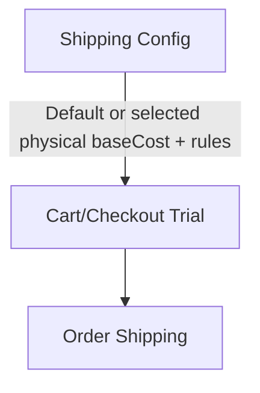

# Shipping

> Menu: **Commerce -> Shipping**  
> Deep link: `/_Admin/commerce/shippings?SiteId={siteGuid}`  
> **Physical create**: `/_Admin/commerce/shippings/create?SiteId=...`  
> **Physical edit**: `/_Admin/commerce/shippings/edit?SiteId=...&id={shippingId}`  
> **Digital create/edit**: `/_Admin/commerce/digital-shippings/create|edit?SiteId=...`

Configure checkout **shipping methods**: physical products use **express shipping** (amount/condition-based surcharges); digital products use **digital shipping** (email delivery of content). **Shipping** in cart and order totals comes from here (server `SiteCommerce` / `Calculator` trial logic).

::: warning Default shipping for new sites (affects cart/order totals)
On first load of site Commerce data, if no **physical shipping** records exist, system auto-creates **one** default shipping (`SiteCommerce.Init()`):

| Item | Default |
|------|---------|
| Name | `Standard` |
| **Base cost** (`baseCost`) | **5** (site currency units, e.g. USD = $5) |
| **Default shipping** | Yes (`isDefault`) |

This **5** is the **base shipping amount**; digital products also get default **Mail Delivery** digital shipping (email delivery, base cost 0).

So on new sites, carts with **non-digital** products and unchanged shipping usually **add this default shipping** at checkout trial. For free shipping or custom rules, edit **Standard** **base cost** (set to `0`), add/remove methods, or configure **supported countries** and **additional cost rules**.

:::

## How to Open

1. In the [Edit menu](../navigation.md#edit-menu), enable **Commerce -> Shipping** (and the parent **Commerce** group).
2. Open **Commerce -> Shipping** in the left sidebar.

Top tabs: **Physical products** / **Digital products** (URL query `name=express|digital` for deep links).

## Physical Products (Express Shipping)

<DocImage src="/cms/commerce/shippings-express-list.png" alt="Shipping: physical product list, default tag and base cost" width="1120" />

### List

| Column / Action | Description |
|-----------------|-------------|
| **Name** | Shipping method name; **default** shipping has "Default" tag |
| **Description** | Optional; shown at checkout |
| **Base cost** | `baseCost`, displayed in site default [currency](./currencies.md) |
| **Cost rules** | `additionalCosts` summary: extra shipping when conditions met |
| **Create** | Opens create page |
| **Edit** | Row pencil opens edit page |
| **Set as default** | After selecting **one** row, toolbar **Set as default** (replaces previous default; default row cannot be selected for delete) |
| **Batch delete** | Select rows → **Delete** → confirm |

At checkout/cart pricing, when `shippingId` not specified, **non-digital** lines use **default** physical shipping.

### Create and Edit

<DocImage src="/cms/commerce/shippings-express-edit.png" alt="Physical shipping edit: base cost, advanced settings, additional cost rules" width="1120" />

| Section | Description |
|---------|-------------|
| **Name / Description** | Name required; description optional |
| **Base cost** | Number input, suffix site `currencyCode`; fixed shipping when no additional rules match |
| **Advanced settings** (expand) | **Carrier code**, **tracking number match** (regex for logistics), **supported countries** (multi-country with estimated delivery days) |
| **Additional cost rules** | Click **Add cost rule**: each has **cost**, **description**, and **order conditions** (`Condition`, field/operator/value, AND/OR). When matched, **adds** that `cost` to base shipping |

## Digital Products (Digital Shipping)

<DocImage src="/cms/commerce/shippings-digital-list.png" alt="Shipping: digital product list and default Mail Delivery" width="1120" />

Digital products have no physical express fee; shipping method determines **how digital products are sent to buyers** (usually email).

### List

Similar to physical: **Name**, **Description**, **Set as default**, **Create / Edit / Delete**. New sites default to **Mail Delivery** as default.

### Create and Edit

<DocImage src="/cms/commerce/shippings-digital-edit.png" alt="Digital shipping edit: mail server and email template" width="1120" />

| Item | Description |
|------|-------------|
| **Name / Description** | Shipping method identifier |
| **Mail server** | **Kooboo** (site mail address) or **Custom** SMTP (host, port, account, etc.) |
| **Sender address** | Kooboo mode: select from mail module |
| **Email template** | Subject and body; **Preview** / edit **Code** (template variables per UI) |
| Delivery content | Together with `digitalItems` from [product detail -> digital products](./product-management-detail.md#digital-products) forms what buyers receive |

On order create, digital product orders link default or specified `digitalShippingId`.

## Relationship with Carts and Orders

| Scenario | Behavior |
|----------|----------|
| Cart with physical products | Trial adds **shipping**; when no shipping selected, uses **default** physical **base cost + matched additional fees** |
| Digital products only | Uses digital shipping to send; usually no physical `baseCost` |
| Mixed cart | Physical lines per express rules; digital lines per digital shipping flow |
| Admin [cart](./carts.md) **checkout** | Same as storefront; can verify shipping includes default **5** unit base fee |

After shipping changes, existing carts may need refresh or recalculation for new amounts (per implementation).

## Related

- [Settings](./settings.md) — weight unit (shipping may reference product weight)  
- [Currencies](./currencies.md) — shipping currency display  
- [Product types](./product-types.md) · [Product detail](./product-management-detail.md) — digital products and delivery items  
- [Carts](./carts.md) · [Orders](./orders.md)  
- [k.commerce.shipping](../../api/commerce/shipping.md)
