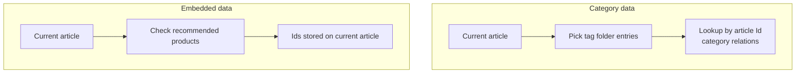

# Content Folder Settings

> Open from row **Settings** (gear) or the **New** wizard on the [content folder list](./contents-folders-list.md)  
> Dialog title is usually **Settings**, with three tabs: **Basic**, **Related data**, **Fields**

Configure content folder metadata, associations with other content folders, and **field display order** for admin entry/list UIs. Not used to fill specific field values for one entry (that is on the [content entry](./contents-entries.md) edit page).

::: tip Prerequisite
A [content type](./content-types.md) must exist. Related data can only target other **folder**-type content folders (not **single content** folders).
:::

<DocImage src="/cms/content/contents-folder-settings-basic.png" alt="Content folder settings: Basic tab" width="960" />

## Basic

| Setting | Description |
|---------|-------------|
| Name | Content folder identifier; `{name}` in `k.content.{name}`; usually cannot change after create |
| Display name | Name shown in the admin |
| Preview URL | Optional; used by [content entry](./contents-entries.md) **Save and preview**, etc. |
| Content type | Binds a [content type](./content-types.md); usually cannot change after save |
| Page size | **Folder** only: entries per page; can choose **Disable pagination** |
| Group | Collapse with other folders in the content folder list |
| Sortable | Whether manual entry ordering is allowed |
| Sort field | When enabled: sort by a field asc/desc, or **drag-and-drop order** |
| Hidden | Hide from the content folder list (use **Show all** to view) |

**Single content** folders omit pagination and other list-related items; follow the UI.

## Related Data

Attach data from **other content folders** to each entry in this folder for admin entry and front-end `k.content` reads. Two kinds:

| Type | Admin label | Data relationship | Typical use |
|------|-------------|-------------------|-------------|
| **Category data** | Category data | Current entry “belongs to” entries in the related folder (tag/category style, many-to-many) | Article belongs to multiple **tags**; product in **categories** |
| **Embedded data** | Embedded data | **Pick and embed** specific entries from the related folder on the current entry (stores Id list) | **Recommended products** on an article, carousel items |

Both require:

| Item | Description |
|------|-------------|
| Target content folder | Select another **folder**-type content folder in the site |
| **Alias** | Key in API and templates; must be unique; English recommended |
| **Display name** | Section title on the admin form |
| **Multiple** | **Category data** only: allow multi-select associations |

**Embedded data** can **add groups**: multiple related folders in one group; group name is for admin display; aliases are configured per folder in the group.

<DocImage src="/cms/content/contents-folder-settings-relation.png" alt="Content folder settings: Related data tab" width="960" />

### Category data vs embedded data (how to choose)



| Question | Prefer |
|----------|--------|
| Relation set defined by “which categories/tags this entry belongs to” | **Category data** |
| Relation set is a manually picked fixed set of entries at edit time | **Embedded data** |
| Need multiple related folders in one block | **Embedded data** + groups |

---

## Reading Related Data in k.content

Get the **current entry** first (`.get()` for folders; direct `k.content.{folderName}` for single-content folders), then access by configured **alias**.

### Category data (alias example `tags`)

```typescript
const post = k.content.Article.get('2024-launch')

// Alias tags: array of related folder entries linked to this article
const tagItems = post.tags  // equivalent to KCategory.All()

for (const tag of tagItems) {
  k.console.log(tag.title)
}
```

### Embedded data (alias example `relatedProducts`)

```typescript
const post = k.content.Article.get('2024-launch')

// Alias relatedProducts: array of embedded product entries on this article
const products = post.relatedProducts  // equivalent to KEmbeddedFolder.All()

for (const p of products) {
  k.console.log(p.title)
}
```

### relatedContent (by name)

You can also use **`relatedContent`** on the entry and call `get` by alias:

```typescript
const post = k.content.Article.get('2024-launch')
const gallery = post.relatedContent.get('sideGallery')
```

Unconfigured aliases return `null` / empty. Exact return types and offline entries: [k.content](../../api/content/index.md) and runtime behavior.

::: tip With k-data
Listing main folder entries on list pages often uses [k-data](../../templateEngine/k-data/query.md); related blocks on detail pages are usually rendered after `get` on a single entry and reading aliases in KScript.
:::

---

## Fields

Controls display order of **editable fields + related sections** on the **content entry** edit page and related UIs (drag to reorder).

| Source | Description |
|--------|-------------|
| Fields marked user-editable in the content type | From the type bound to this folder |
| Configured category/embedded relations | Appear by alias or display name |

Affects admin display order only; field definitions remain in [content types](./content-types.md).

<DocImage src="/cms/content/contents-folder-settings-fields.png" alt="Content folder settings: Fields tab (display order)" width="960" />

On save, if Basic or Related data validation fails, the dialog switches to the corresponding tab.

## Related

| Doc | Description |
|-----|-------------|
| [Content folders](./contents-folders-list.md) | Create folder / single content |
| [Content entries](./contents-entries.md) | Enter relations and field values |
| [k.content](../../api/content/index.md) | API reference |
