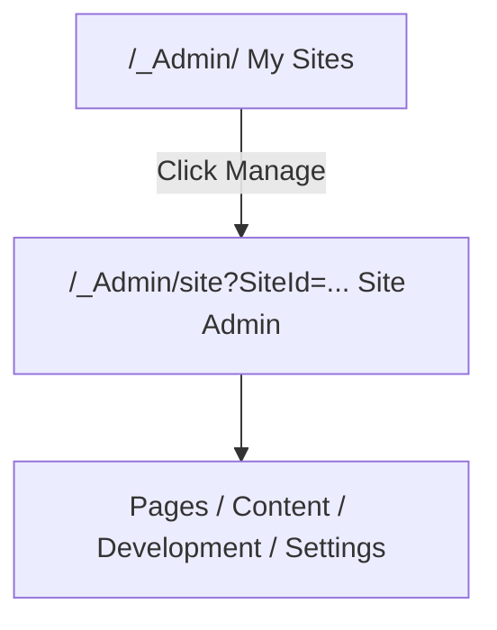

# Login and Site List

> Enter Kooboo from the account-level console, organize sites with folders, and open a site's admin workspace.

This page covers **account-level** screens. These routes usually **do not** contain `SiteId`. Once you click **Manage** on a site and enter the site admin, continue with [Site admin menu overview](../navigation.md).

## Entry URLs

| Scenario | URL example |
|----------|-------------|
| Console root | `https://www.redev.cn/_Admin/` |
| Login page | `https://www.redev.cn/_Admin/login` |
| Site list inside a folder | `https://www.redev.cn/_Admin/?currentFolder={folderName}` |

Kooboo serves the admin frontend under `/_Admin/`. Replace `www.redev.cn` with your own console host when needed.

## Login

<DocImage src="/cms/getting-started/01-login.png" alt="Kooboo login page" width="1120" />

1. Open `/_Admin/` in your browser.
2. If you do not have an active session, Kooboo redirects you to **Login**.
3. Sign in with the methods enabled in your environment.
4. After a successful login, you land on **My Sites**.

## My Sites

<DocImage src="/cms/getting-started/site-list.png" alt="My Sites overview" width="1120" />

The default landing page after login is **My Sites**. The page usually contains:

### Top actions

| Button | Purpose |
|--------|---------|
| **Create Site** | Opens the site creation flow. See [Create a site](./create-site.md). |
| **New Folder** | Adds a folder to organize multiple sites under the same account. |

### Search and view modes

- **Search Sites** filters the site list by name.
- **List / Grid** changes how folders and sites are displayed.

### Folders

Folders only change how sites are grouped on the account homepage. They **do not** change the site's own content or runtime data.

| Action | Description |
|--------|-------------|
| Open a folder | Click the folder card or row; the URL gets `?currentFolder={folderName}` |
| Return to all sites | Use the breadcrumb or remove the `currentFolder` query string |
| Create a folder | Click **New Folder** and enter a name |
| Rename / Delete | Use the row or card action menu |

<DocImage src="/cms/getting-started/02-site-list-folders.png" alt="Site list inside a folder" width="1120" />

### Site cards or rows

Each site usually shows a preview thumbnail, site name, and online state. Common actions:

| Action | Description |
|--------|-------------|
| **Manage** | Opens the site's admin dashboard; the URL becomes `/_Admin/site?SiteId={siteGuid}` |
| **Share** | Opens sharing or preview-related actions |
| **More actions** | Export, move to folder, delete, and similar actions |

<DocImage src="/cms/getting-started/03-enter-site.png" alt="Entering the site admin dashboard" width="1120" />

Once you are inside the site admin, the left sidebar switches to site-level menus such as **Content**, **Development**, **Commerce**, and **Site Settings**.

## Do Not Mix Up the Two Admin Levels

| Level | Example URL | Docs |
|-------|-------------|------|
| Account level | `/_Admin/`, `/_Admin/create` | This page, [Create a site](./create-site.md) |
| Site level | `/_Admin/site/pages?SiteId=...` | [Site admin menu overview](../navigation.md) |
